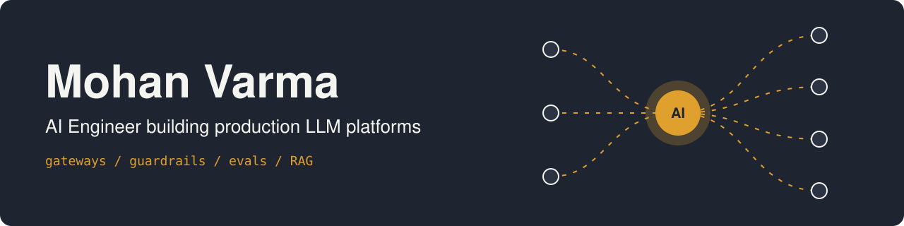
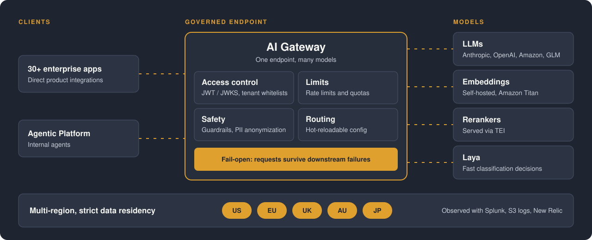

  

  
  
  

**AI Engineer at Cornerstone OnDemand.** I build the platform layer that takes LLMs from prototype to secure, reliable production.

## What I do at work

I work on Cornerstone's centralized AI Gateway, a single governed endpoint for LLM, embedding and reranker models.

  

- **Scale:** serves 30+ enterprise applications and the internal Agentic Platform
- **Models:** onboarded ~10 security-approved models through hot-reloadable routing
- **Infrastructure:** led the GCP to AWS migration of 4 self-hosted embedding models and 1 reranker, sharing GPUs with NVIDIA time-slicing

Before that, I automated LLM evaluation with DeepEval and MLflow, and built a Docling-based document processing service for enterprise RAG pipelines.

## Selected projects

| Project | What it is | Built with |
| --- | --- | --- |
| [laya-finetuning](https://github.com/mohanvarmaa22/laya-finetuning) | Fine-tuned a prompt safety classifier on BeaverTails. Accuracy rose from 51–57% at baseline to 75% on a balanced 400-prompt test set, and calibration error fell to 0.035, at 34 ms per prompt. | Python, PyTorch DDP, Kaggle 2×T4 |
| [Decision-logs](https://github.com/mohanvarmaa22/Decision-logs) | Keeps the "why" behind AI-written code. Captures short decision notes from Claude Code sessions, secret-scans them and stores them locally. *Prototype, in active development.* | Go, Claude Code plugin |
| [jev-testing](https://github.com/mohanvarmaa22/jev-testing) | Experiments with Jev decision models through Vercel AI Gateway: choice routing, safety gating and ticket priority scoring. | Python |

## Tech I use

  

- **GenAI:** AWS Bedrock, RAG, embeddings, rerankers, model routing, LangChain, Docling
- **Evaluation and safety:** DeepEval, MLflow, Bedrock Guardrails, PII anonymization
- **Backend:** Python, FastAPI, AsyncIO, Pydantic, Apache Pulsar, ClickHouse
- **Infrastructure:** Kubernetes (EKS), Helm, Docker, AWS, GPU/CUDA
- **Observability:** Splunk, New Relic, Prometheus, Grafana
